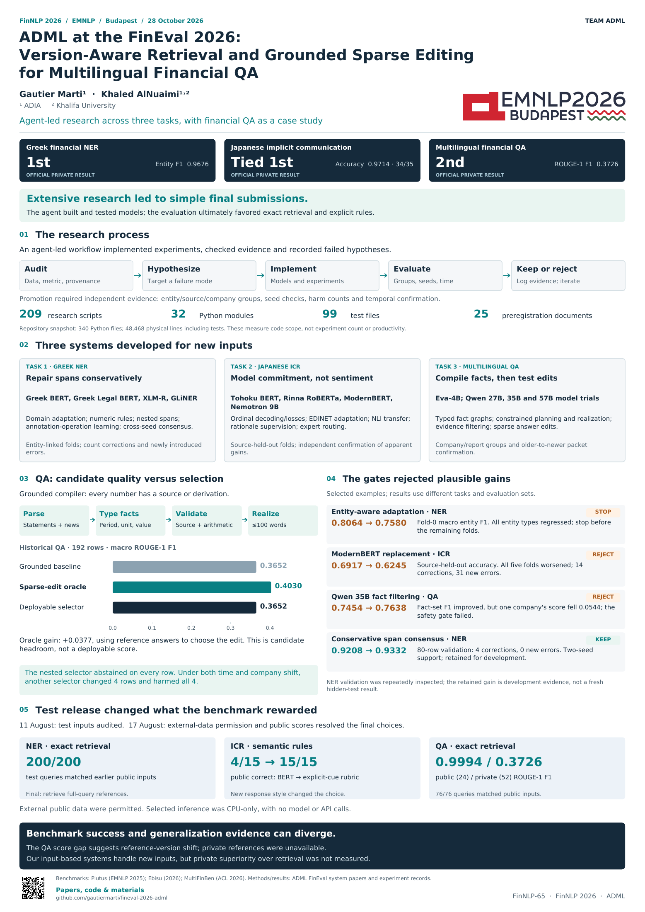

# ADML at FinEval 2026

Research code, system papers, and presentation materials for **Greek financial named entity recognition**, **Japanese implicit communication recognition**, and **multilingual financial question answering** at FinNLP / EMNLP 2026, Budapest.

**Gautier Marti** · **Khaled AlNuaimi**

ADIA · Khalifa University

| Task | Official private result | Selected submission | Paper |
|---|---|---|---|
| Greek financial NER | **1st** · entity F1 **0.9676** | Historical public-reference retrieval | [PDF](papers/task1/main.pdf) · [LaTeX](papers/task1/main.tex) |
| Japanese implicit communication | **Tied 1st** · accuracy **0.9714** (34/35) | Explicit commitment/refusal rules | [PDF](papers/task2/main.pdf) · [LaTeX](papers/task2/main.tex) |
| Multilingual financial QA | **2nd** · ROUGE-1 F1 **0.3726** | Historical public-reference retrieval, capped at 100 words | [PDF](papers/task3/main.pdf) · [LaTeX](papers/task3/main.tex) |

[Official tasks and results](https://www.finnlp2026sharedtask.info/) · [FinNLP workshop](https://sigfintech.github.io/finnlp2026/) · [Results and interpretation](docs/results.md) · [How to reproduce](docs/reproduction.md)

The official leaderboards list this team under the account **`gmarti`**. Scores use different task metrics and are not directly comparable across tasks.

## Papers and presentation

- **Poster:** [A0 PDF](papers/conference/FinNLP65ADMLPoster.pdf) · [preview](papers/conference/FinNLP65ADMLPosterPreview.png) · [editable SVG](papers/conference/FinNLP65ADMLPoster.svg).
- **Talk:** [slides PDF](papers/conference/FinNLP65ADMLSlides.pdf) · [editable PowerPoint](papers/conference/FinNLP65ADMLSlides.pptx) · [slide overview](papers/conference/FinNLP65ADMLSlidesPreview.jpg).
- **Video:** [download MP4, 4:50 / 11.6 MB](papers/conference/FinNLP65ADMLVideo.mp4) · [captions](papers/conference/FinNLP65ADMLVideo.vtt) · [transcript](papers/conference/video/script.md). The video uses synthetic narration.
- **Paper sources:** [build instructions](papers/README.md). The accepted QA title is retained in the conference presentation, which discusses research across all three tasks.

<a href="papers/conference/FinNLP65ADMLPoster.pdf"></a>

## What this work shows

The research explored Greek encoders and conservative span consensus, Japanese ordinal models and auxiliary supervision, and a grounded financial fact compiler with sparse edits and abstaining selectors. Evaluation gates rejected several plausible improvements. The three papers explain the successful experiments and the negative results.

After the test release and clarification permitting external data, the selected submissions used a simpler CPU workflow: historical reference retrieval for NER and QA, and explicit rules for Japanese ICR. These selected paths use no model API or neural checkpoint. **Leaderboard success does not by itself establish performance on unfamiliar inputs.** The QA public/private gap also motivates careful treatment of dataset and reference versions.

## Quick start

Use Python **3.12**. The selected workflow needs only pandas and PyArrow:

```bash
python3.12 -m venv .venv
source .venv/bin/activate
python -m pip install -r requirements.txt
python scripts/download_data.py --group test
python scripts/run_final_submission.py \
  --task 2 --input data/raw/test_release_20260817_hf/task2/test.parquet \
  --output work/task2.csv --work-dir work/task2 --device cpu
```

The Japanese rubric can be reproduced using the public test input alone. Exact replay of NER and QA also needs the historical reference snapshots in [the data manifest](data/manifest.json). On 15 October 2026, the historical source endpoints returned HTTP 401 to anonymous requests. The downloader checks immutable hashes and reports unavailable files; it never substitutes newer data. See [data access and local snapshot import](data/README.md).

```bash
python -m pip install -r requirements-dev.txt
python -m pytest
```

The default tests cover the selected inference components, the public runner, data-integrity checks, and release packaging without downloading a model. [Reproduction instructions](docs/reproduction.md) explain replaying all three submissions and checking the expected output hashes.

## Explore the research

| Location | Contents |
|---|---|
| [`src/fineval/`](src/fineval/) | Financial parsing, metrics, validation, edit selection, and task-specific modules |
| [`scripts/`](scripts/) | Training, ablations, evaluation, inference, and audit scripts |
| [`tests/`](tests/) | Original research tests; some require the research dependencies or external data |
| [`docs/`](docs/) | Research logs, preregistered protocols, and public reproduction guides |
| [`artifacts/`](artifacts/) | Selected aggregate experiment summaries supporting the papers and poster |
| [`provenance/`](provenance/) | Source-export hashes, release inventory, and validation evidence |

Start with the [research guide](docs/research.md). These historical scripts include model experiments and data-dependent analyses; they are not all part of the lightweight leaderboard runner. Large checkpoints, benchmark corpora, row-level reference answers, and local experiment caches are obtained or generated separately.

## Citation and terms

Use [CITATION.cff](CITATION.cff) for the companion repository, or cite the relevant [system paper](papers/README.md). Dataset, paper-template, font, and conference-logo terms are documented in [NOTICE.md](NOTICE.md) and [data/README.md](data/README.md).

An open-source license for the original code has not yet been selected. Public availability and reuse permission are separate; see [NOTICE.md](NOTICE.md).
